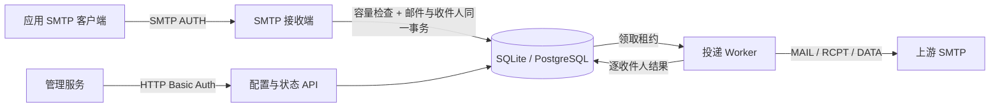

# 网关实现约束

完整需求与验收清单见 [issue #2](https://github.com/zhangzqs/smtp-gateway-go/issues/2)。本文记录当前实现的关键数据边界，便于后续修改队列和投递行为。

## 数据流

`250` 只在入队事务提交后返回。`queue_capacity` 单例行将容量检查与计数更新串行化；邮件正文以 BLOB/BYTEA 保存在 `messages`，实际 SMTP envelope 收件人保存在 `recipients`。终态记录超过保留期后，清理事务同时删除正文并释放容量。

## 领取与完成

领取查询使用数据库时间判断收件人是否到期、邮件是否到期及旧租约是否失效；带全部条件的 UPDATE 写入随机 `claim_token`，只有影响一行的 Worker 能投递。每次仅加载已到期且状态为 `pending` 的收件人。

网络投递在数据库事务外进行。完成投递时再次检查 token 和租约，然后在一个事务里更新逐收件人结果并释放租约。旧 Worker 的结果不能覆盖新领取的结果。DATA 成功后、本地完成事务之前发生崩溃时可能重发；不按 Message-ID 去重，以保留至少一次投递语义。

上游 `RCPT` 的 4xx 延期重试，5xx 保留永久失败；只有通过 RCPT 的收件人才进入 DATA。DATA 的最终 2xx 标记为 `accepted_by_upstream`；DATA 4xx 或结果未知进入重试，5xx 标记失败。上游身份、TLS、认证或 MAIL FROM 的故障作为可修正通道故障重试。退避加入抖动，并由最大存活时间封顶。手工重试只重置仍在保留期内的失败或过期收件人，并开启新存活窗口。

## 配置与部署

静态配置从文件一次加载；可选的完整 `relay` 文件配置优先于数据库配置，且不覆盖数据库原记录。无文件配置时，管理 API 的 PUT 在单个数据库事务里保存完整配置。上游密码使用 AES-GCM 加密，密钥来自静态配置；缺少密钥或 API 配置模式下无法解密密码会使启动失败。一个投递尝试读取一个完整配置快照。

SQLite 使用 WAL、`synchronous=FULL`、外键和单连接，适合单实例及本地持久卷。PostgreSQL 使用数据库 advisory lock 串行迁移，队列租约与配置写入由数据库事务协调，支持多实例。HTTP Basic Auth 和 SMTP AUTH 使用独立凭据；生产环境应启用加密传输。

## 验证入口

`task ci` 覆盖静态检查、漏洞扫描、race 测试和无 CGO 构建。`task integration` 使用 Testcontainers 对 PostgreSQL 运行与 SQLite 相同的队列契约，并使用本次源码构建的容器镜像、PostgreSQL、SQLite 持久卷与 Mailpit 验证 SMTP 提交、上游中断、网关重启、恢复投递和邮件内容。
